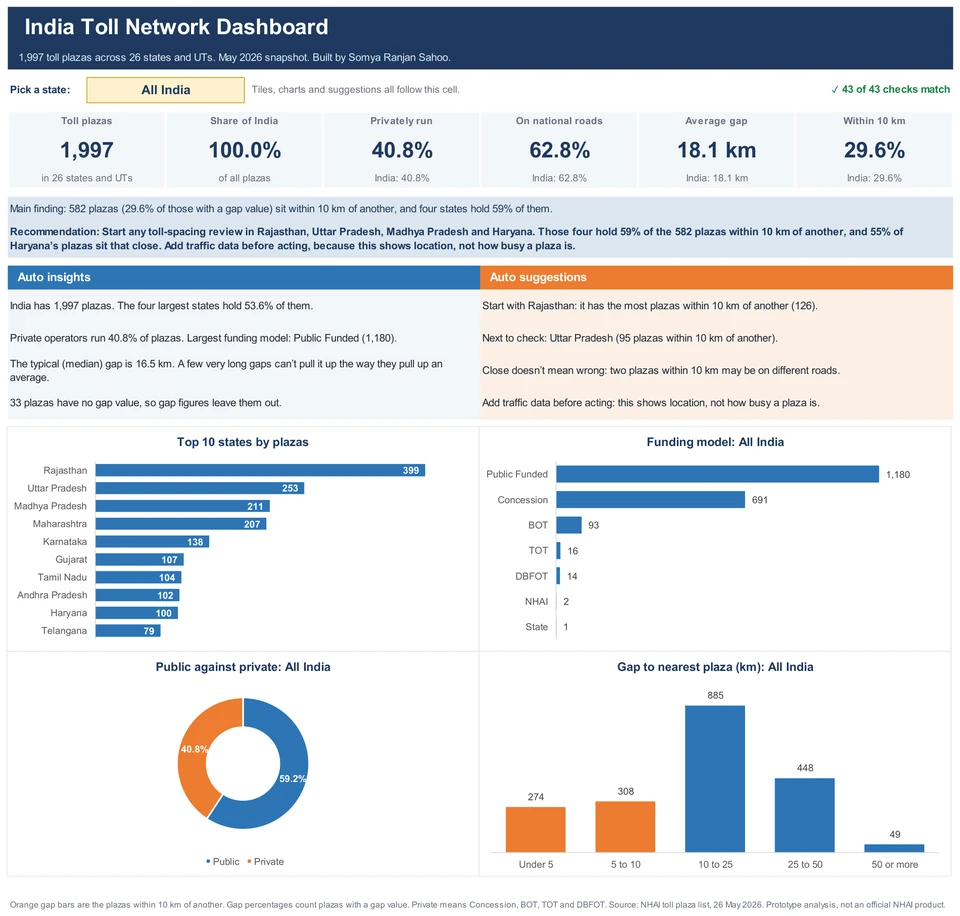

# India's toll network, in data

An end-to-end analysis of the plaza registry from my Smart Toll Plaza project (list dated 26 May 2026).

## One project, two repos

| Part | Repo | What it holds |
|---|---|---|
| **System** | [smart-toll-plaza-system](https://github.com/somyaranjansahoo6422/smart-toll-plaza-system) | The working app: number plate reading, toll payments, the GIS map and analytics |
| **Data and analysis** (you are here) | [india-toll-network-analysis](https://github.com/somyaranjansahoo6422/india-toll-network-analysis) | The full analysis of the plaza data the app runs on: cleaning log, SQL, findings and an Excel dashboard |

Both repos use the same registry of 2,003 toll plazas. See them together on [my portfolio](https://somyaranjansahoo6422.github.io/).

**Questions:** where are India's toll plazas, who runs them, how close together are they, and can this data be trusted?

## Run it

```
pip install pandas numpy
python analysis.py
```

It reads `toll_plazas_raw.csv` (the registry the [toll system](https://github.com/somyaranjansahoo6422/smart-toll-plaza-system) runs on), runs the SQL in `queries.sql`, and writes `toll_plazas_clean.csv`, `cleaning_log.csv`, `toll.db` and `results.json`.

## Files

| File | What it is |
|---|---|
| `analysis.py` | Cleaning pipeline: every change is logged |
| `queries.sql` | The questions in SQL (CTEs, window functions). Written for MySQL 8, run here on SQLite |
| `cleaning_log.csv` | All 159 records that were fixed or flagged, and why |
| `india-toll-dashboard.xlsx` | Excel dashboard built on the clean data |

## Excel dashboard



Open `india-toll-dashboard.xlsx` and pick a state in the yellow cell on the Dashboard sheet. The tiles, insights, suggestions and charts follow that choice. Everything reads from one table, so a row added to the Data sheet updates the numbers, state ranking and dropdown with no macros. It needs Excel 2010 or later, and the Checks sheet compares it with fixed reference figures.

## Main findings

- Four states (Rajasthan, Uttar Pradesh, Madhya Pradesh, Maharashtra) hold 53.6% of 1,997 plazas.
- 73.5% of national-road plazas are publicly funded, while 65% of state-road plazas use private models.
- Karnataka has the highest private share among big states (71.7%), Punjab the lowest (17.6%). Big means 50 or more plazas: Odisha is lower at 17.1%, but has only 35.
- 29.6% of plazas have another plaza within 10 km in a straight line.

## Recommendation

Start any toll-spacing review in Rajasthan, Uttar Pradesh, Madhya Pradesh and Haryana. Those four hold 59% of the 582 plazas within 10 km of another, and 55% of Haryana’s plazas sit that close. Add traffic data before acting, because this shows location, not how busy a plaza is.

## Limits

A single snapshot with no traffic or revenue data. Distances are straight lines on any road, so they show clusters, not rule breaches. Concession, BOT, TOT and DBFOT are grouped as "private".
